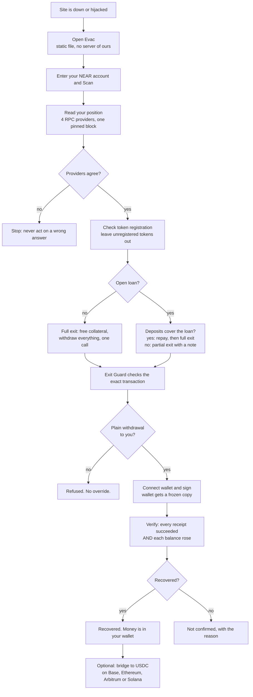
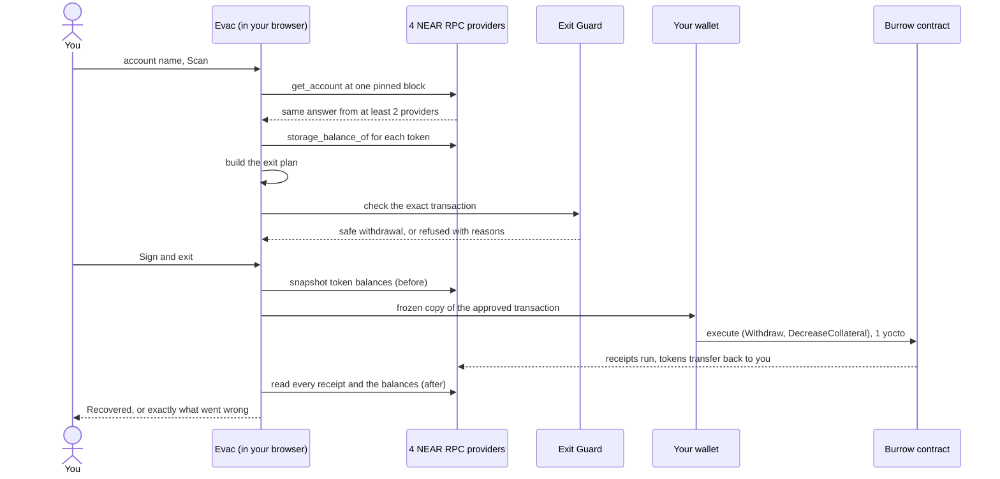
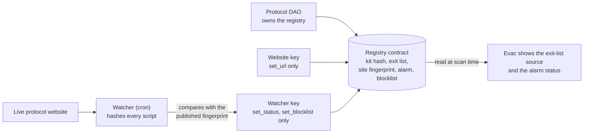

# How Evac works: the flow

Evac is a fire exit for NEAR DeFi. This page follows one exit from start to finish, shows what protects it, and says plainly
which parts have been seen working on real data and which haven't.

- [1. The user flow](#1-the-user-flow)
- [2. Step by step under the hood](#2-step-by-step-under-the-hood)
- [3. What can stop or change the flow](#3-what-can-stop-or-change-the-flow)
- [4. The protection layer](#4-the-protection-layer)
- [5. The operator flow](#5-the-operator-flow)
- [6. Code map](#6-code-map)
- [7. What is proven and what isn't](#7-what-is-proven-and-what-isnt)

## 1. The user flow

## 2. Step by step under the hood

| Step | What runs | Detail |
|---|---|---|
| Scan | `scanBurrow` over `quorumView` | Pins the lowest "final" block all providers can serve. At least 2 must answer and all answers must be identical |
| Storage check | `checkStorage` | Up to 4 tokens at a time. An unregistered token's withdrawal would be refunded, so it is left out |
| Plan | `planExit` | No debt: `DecreaseCollateral` for each collateral token, then `Withdraw` for each token, in one `execute`. With debt: if non-collateral deposits cover each loan plus 1%, `Repay`, `DecreaseCollateral`, `Withdraw` in one `execute_with_pyth`; otherwise only `Withdraw` of non-collateral deposits, and the shortfall is shown |
| Guard | `checkTx` | Contract and method allowlist, deposit exactly 1 yocto, exact argument shape, only withdrawal actions, signer must be the connected account |
| Sign | `signGuarded` | Guards again, then sends a frozen copy, so nothing can change between the check and the signature |
| Verify | `outcomeFailures`, `evaluateExit` | Every receipt must succeed and every withdrawn token's balance must rise |
| Resume | `?transactionHashes=` | Redirect wallets leave the page. Evac saved the starting balances first and finishes the check on return |
| Bridge | `requestQuote`, `checkBridgeTx` | A separate guard accepts only: `ft_transfer` of the quoted amount, to the quoted deposit address, 1 yocto |

## 3. What can stop or change the flow

| Situation | What Evac does |
|---|---|
| Two RPC providers disagree | Stops. It does not guess |
| One provider is down | Carries on and shows how many agreed |
| Account has no Burrow position | Says so |
| Open loan, other deposits cover it | Repays the loan from them, then a full exit (price-checked call) |
| Open loan, deposits fall short | Partial exit of non-collateral deposits, and says how much is missing |
| Account not registered with a token | Leaves that token out and says what to register |
| The Guard refuses | Nothing is sent. The reasons are shown in plain words |
| Wallet is a different account than the one scanned | Signing is disabled |
| A later step fails after the first succeeds | "Not confirmed as recovered", with the failing step |
| Transaction succeeded but a balance didn't rise | "Not confirmed", with the likely cause |
| Wallet redirects away and back | Resumes and finishes the verification |

## 4. The protection layer

The watcher raises:

| Alarm | Triggered by |
|---|---|
| **Compromised** | Different content behind the same address, a new inline script, or a script from a new origin |
| **Degraded** | A new same-origin file or an expected one missing. Usually a normal redeploy |
| **Ok** | Everything matches the published fingerprint |

Volatile per-request tokens inside inline snippets (such as Cloudflare's) and non-executable JSON data blocks are ignored, so
a normal page load does not raise a false alarm.

## 5. The operator flow

For a protocol team (or us, as the demo operator). Commands are in [DEPLOY.md](DEPLOY.md).

1. Deploy the registry contract and hand ownership to a DAO.
2. Register the protocol: its exit list (manifest) and official site.
3. Publish the site fingerprint (`scripts/watcher.ts --baseline`).
4. Grant the watcher key (`set_status`, `set_blocklist` only) and, if wanted, the website key (`set_url` only).
5. Build the kit, hash it (`scripts/hash-out.mjs`) and publish the hash. Anyone can then run `scripts/verify-kit.ts`.
6. Run the watcher on a schedule. Evac shows the alarm to users.

## 6. Code map

| Flow step | File |
|---|---|
| RPC quorum | `src/lib/rpc.ts` |
| Scan and plan | `src/lib/burrow.ts`, `src/lib/manifest.ts` |
| Storage check | `src/lib/storage.ts` |
| Exit Guard | `src/lib/guard.ts` |
| Wallet signing | `src/lib/wallet.ts` |
| Recovered check | `src/lib/verify.ts` |
| Bridge out and Bridge Guard | `src/lib/intents.ts` |
| Registry client | `src/lib/registry.ts` |
| Site fingerprint and alarm rules | `src/lib/sitecheck.ts`, `scripts/watcher.ts` |
| Registry contract | `contracts/registry/src/lib.rs` |
| The screens | `src/app/` (landing, `/dashboard`, `/docs`) |

## 7. What is proven and what isn't

| Part | Status |
|---|---|
| Scan, storage check, plan and Guard on 11 real accounts (read-only) | **Seen working** |
| Guard and receipt checker on 18 real historical `execute` transactions | **Seen working**: 18 of 18 accepted, every receipt clean |
| 1Click dry quote and a real site fingerprint | **Seen working** |
| Unit tests: 99 TypeScript, 15 contract | **Passing** |
| Wallet pop-up, signing, redirect resume | **Not tried with a real wallet** |
| "Recovered" check on a live exit | **Not tried** (tested on fixtures and historical receipts) |
| Real bridge swap | **Not tried** (dry quote only) |
| Registry, DAO, watcher publishing | **Written and tested, not deployed** |
| Full exit for accounts with a loan | **Built, not tried with real money.** Uses `execute_with_pyth`, which most live Burrow traffic uses |
