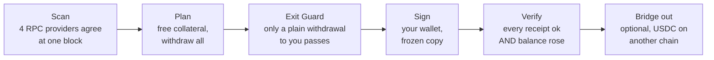

<p></p>

# Evac

**A fire exit for NEAR DeFi.** The website is hijacked or gone, but your money is still in the contracts. Evac is the way out that never goes through the front door.
Evac reads your position straight from the contracts, builds the withdrawal on your machine, refuses anything that is
not a plain withdrawal to you, and tells you honestly whether the money really came back.

Built for the NEAR Hackathon. Tracks: Unstoppable DeFi, AI Security & Defense, Open Innovation.
Design notes: [docs/architecture.md](docs/architecture.md) (the original plan; this README says what was actually built).

## How it works



1. **Scan.** Reads your Burrow lending position (`contract.main.burrow.near`) from four independent NEAR RPC providers at one pinned
   block. One dead provider is tolerated; providers that disagree stop the read.
2. **Plan.** One `execute` call: free collateral, then withdraw everything. Tokens your account isn't registered with are left
   out (their withdrawal would be refunded) and the plan says so. With an open loan, if your other deposits can repay it (plus 1% for interest), the plan repays the
   loan and then exits fully through Burrow's price-checked `execute_with_pyth`; otherwise you get a partial exit and are told
   what is missing.
3. **Guard.** The **Exit Guard** checks the exact transaction before the wallet sees it. It refuses `AddKey`, `Transfer`,
   `DeleteAccount`, unknown contracts or methods, any deposit other than exactly 1 yoctoNEAR, extra fields, and anything it
   cannot decode. There is no override. A 21-payload attack corpus is in the tests.
4. **Sign.** NEAR wallet-selector (MyNearWallet, Meteor, HOT). The wallet receives a frozen copy of what the Guard approved.
5. **Verify.** "Recovered" shows only if **every receipt** succeeded **and** each token balance rose. On NEAR the first
   receipt can succeed while the token transfer fails and the protocol refunds the deposit.
6. **Bridge out (optional).** Send what you recovered to USDC on Base, Ethereum, Arbitrum or Solana through NEAR Intents'
   1Click API. A separate Bridge Guard accepts only the exact quoted transfer to the quoted deposit address.

Behind it, a **registry contract** (owned by a DAO) publishes the kit hash, exit list, site fingerprint and alarm, and a
**watcher** fingerprints the live site and raises `Compromised` on changed or injected scripts. The website key and the watcher
key are NEAR function-call keys that can each call only their own methods. You can also paste any transaction from a site you
distrust and Evac tells you whether it is a safe exit.

No server of ours is in the path: the app is a static export, and the build is reproducible
(`npm run build && node scripts/hash-out.mjs` gives the same hash every time).

**Full flow, failure branches and a code map: [FLOW.md](FLOW.md).**

## Status

| Piece | State |
|---|---|
| RPC quorum at a pinned block | done, tested, run against mainnet |
| Burrow scan + exit plan | done; live scan of a real account works |
| Exit Guard + attack corpus | done (21 payloads refused, real exit accepted) |
| Wallet signing (`wallet-selector`) | done; **not yet tried with a real wallet** |
| Tested on real mainnet data (read-only) | 11 real Burrow accounts scanned and planned; 18 real historical `execute` transactions replayed through the Guard (all accepted) and the receipt checker (all clean). See below |
| Receipt + balance "Recovered" check | done, tested on fixtures; **not yet run on a real exit** |
| Registry contract (Rust) | done, 15 unit tests, wasm builds; **not deployed** |
| Registry client + manifest comparison | done, tested with fakes; needs a deployed registry to run for real |
| Watcher | done; fingerprinting tested against a real DeFi site (app.rhea.finance, used only as a test target); publishing needs a deployed registry |
| 1Click bridge-out + Bridge Guard | done; dry quote verified live; **real bridge not run** |
| Storage-registration pre-check | done, tested |
| Reproducible build + hash tools | done |

**Not verified on mainnet:** a real withdrawal, and especially the repay-and-exit path for accounts with a loan (it uses
`execute_with_pyth`, built from the shape of real past calls). The live Burrow contract differs from its archived source, so
the first real exit with a small position is the key test. If a transaction fails, nothing moves and the Recovered check says so.

## Tested against real mainnet data

Read-only, on 10 Nov 2026. Nothing was signed or sent.

- **11 real accounts** of every kind (no debt with collateral, supplied only, with open loans, one that doesn't exist). Each was scanned through the 3-provider quorum, planned, and checked by the Guard. Every plan was accepted by the Guard. Accounts with loans got the partial plan.
- **18 real historical `execute` transactions** by real users (10 withdrawals, 8 repayments), found by scanning about 2,800 recent transactions on the Burrow contract. The Guard accepted all 18, and the receipt checker found every receipt successful.
- **Findings that changed the code:** scans were slow because storage checks ran one at a time (81 s down to about 4 s); several real accounts aren't registered with `token.burrow.near`, so that one withdrawal would be refunded, so Evac now leaves unregistered tokens out of the plan and says so; and the site fingerprint raised a false alarm on a real site because of a per-request token in Cloudflare's snippet, so volatile tokens and JSON data blocks are now ignored.
- **What the real traffic shows:** most user transactions on Burrow today use `execute_with_pyth`, not `execute`. Evac now builds and accepts `execute_with_pyth` (same actions, 300 TGas) for accounts with a loan. That path is covered by tests but not yet tried with real money.

## Save the kit and the browser extension

- **Exit kit.** `npm run kit` packs the built app into `kit/evac-kit.tar.gz` with a stand-alone `verify.mjs` (needs only Node)
  and a `SHA256` file. One changed or added file gives `MISMATCH`. The page `/kit` explains it. Compare the hash with the one the
  protocol publishes in its registry.
- **Chrome extension.** `npm run extension` builds `extension/dist` (load it unpacked). It reads the registry and warns on
  look-alike addresses, on the official site when a script changed or a new origin appeared, and when the protocol has raised an
  alarm. It warns only; the Exit Guard still decides what can be signed. `npm run demo:sites` serves local demo pages and prints
  demo data, so it can be shown without a deployed registry. Tested in a real Chrome against local pages
  (`scripts/e2e-extension.mts`: 8 of 8). The registry isn't deployed yet, so on mainnet it has nothing to compare with until it is.

## Run

```bash
npm install --legacy-peer-deps
npm test                                          # 111 TypeScript tests
(cd contracts/registry && cargo test)             # 15 contract tests
npx tsx scripts/scan.ts <account.near>            # live scan + guarded plan from the terminal
npx tsx scripts/watcher.ts --url https://app.rhea.finance --baseline    # example: print a site fingerprint
npm run dev                                       # the app
npm run build && node scripts/hash-out.mjs        # static export + its hash
```

How it works end to end: [FLOW.md](FLOW.md). Deploying the registry, DAO and watcher: [DEPLOY.md](DEPLOY.md). Demo script: [DEMO.md](DEMO.md).
Submission text: [SUBMISSION.md](SUBMISSION.md).

## Layout

```
extension/      Chrome extension (page check against the registry)
src/lib/        rpc (quorum) · burrow (scan, plan) · guard · wallet · verify · registry · sitecheck · intents · storage
src/app/        the static web app
scripts/        scan · watcher · verify-kit · hash-out · make-kit · build-extension
contracts/registry/   Rust registry contract (near-sdk 5.20)
test/           111 tests: quorum, guard, plan, verify, registry, sitecheck, intents, hijack corpus
```

## Design credit

The idea and structure come from the authors' earlier ETHGlobal Mumbai entry (an exit kit rooted in an ENS name). This
repository is a new implementation for NEAR: the registry contract, function-call-key permissions, the NEAR Exit Guard,
the asynchronous-receipt check, the Burrow adapter and the 1Click bridge are all new code.
