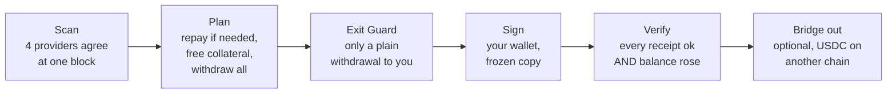

<p align="center">
  
</p>

<h1 align="center">Evac</h1>

<p align="center">
  <b>A fire exit for NEAR DeFi.</b><br>
  Website hijacked or gone? Your funds are still on chain. Evac gets them out, safely.
</p>

<p align="center">
  <a href="FLOW.md">How it flows</a> ·
  <a href="DEMO.md">Demo plan</a> ·
  <a href="DEPLOY.md">Deploy</a> ·
  <a href="SUBMISSION.md">Submission text</a>
</p>

<p align="center">
  
  
  
</p>

## The problem

When a DeFi website is hijacked or goes offline, nothing is wrong with the contracts. People sign on a perfect copy of the
site and approve a drainer, or find the site gone and can't reach their money. The usual fallback, a block explorer's
"write contract" page, is just another website.

Evac is a way out that never goes through the front door.

## How it works



Full flow, failure branches and a code map: **[FLOW.md](FLOW.md)**.

## What's built

| | Feature | What it does |
|---|---|---|
| **Exit** | Position scan | Reads your Burrow position straight from the contract through four RPC providers at one pinned block. One may be down; if they disagree, Evac stops |
| | Exit plan | No loan: free collateral and withdraw everything in one call. Loan: if your other deposits cover it (plus 1% for interest), repay then exit fully; otherwise a partial exit that says what is missing |
| | Storage check | Leaves out tokens your account isn't registered with, since their withdrawal would be refunded, and says so |
| **Safety** | Exit Guard | Fail-closed. Refuses `AddKey`, transfers, account deletion, unknown contracts or methods, any deposit but 1 yocto, and anything it can't decode. No override. 21-payload attack corpus in the tests |
| | Recovered check | "Recovered" only if every receipt succeeded and each balance rose. On NEAR the first step can succeed while a later transfer fails |
| | Check a transaction | Paste anything a site asks you to sign and see in plain words whether it's a safe withdrawal |
| **Leave** | Bridge out | Optional swap to USDC on Base, Ethereum, Arbitrum or Solana through NEAR Intents (1Click), with its own guard |
| | Wallets | MyNearWallet, Meteor and HOT through wallet-selector; redirect wallets resume the check on return |
| **Trust** | Registry contract | Rust, DAO-owned. Publishes the kit hash, exit list, site fingerprint, alarm and look-alike blocklist. Its website and watcher keys are NEAR function-call keys that can each call only their own methods |
| | Watcher | Fingerprints the live site and raises `Compromised` on a swapped or injected script |
| **Carry** | Exit kit | `npm run kit` packs the app into one file with a stand-alone `verify.mjs`. `MATCH` or `MISMATCH` against the published hash |
| | Browser extension | Chrome extension that warns on look-alike sites, changed scripts and protocol alarms. Includes local demo pages |
| | Reproducible build | Same source, same hash, every time. No server of ours in the path |

## Proof

Everything below was run read-only on live NEAR data, or in tests. Each row has a command.

| What we tried | Result | Command |
|---|---|---|
| 11 real Burrow accounts (no loan, loan, supplied only, missing) | All scanned, planned and Guard-approved | `npx tsx scripts/scan.ts zavodil.near` |
| 18 real past Burrow transactions replayed | 18 of 18 accepted, receipts clean | `npx vitest run test/hijack-corpus.test.ts` |
| Hijack payloads against the Guard | All refused, the real exit passes | `npx vitest run test/guard.test.ts` |
| A provider lies or goes quiet | Read continues safely or stops | `npx vitest run test/rpc.test.ts` |
| A transfer fails behind a success | Not marked recovered | `npx vitest run test/verify.test.ts` |
| A real site gets a swapped script | Flagged | `npx tsx scripts/watcher.ts --url <site> --baseline` |
| Extension in a real Chrome (clean, tampered, look-alike, both alarms) | 8 of 8 | `npm i --no-save puppeteer-core && npx tsx scripts/e2e-extension.mts` |
| A registry key steps outside its role | Rejected | `cd contracts/registry && cargo test` |
| Build twice | Same hash | `npm run build && node scripts/hash-out.mjs` |

## Not proven yet

Said plainly, so nobody is surprised:

- A **real withdrawal signed with a real wallet**. Wallet signing and the live "Recovered" check are tested on fixtures and historical receipts only.
- The **repay-and-exit** path for accounts with a loan (uses Burrow's `execute_with_pyth`). Built from the shape of real past calls, covered by tests, not tried with real money.
- A **real bridge swap** (only a dry quote was run).
- The **registry, DAO and watcher publishing** on mainnet. Written and tested, not deployed.
- Only Burrow is supported. Ref and liquid staking are planned.

## Quick start

```bash
npm install                                   # .npmrc sets legacy-peer-deps for the wallet libraries
npm run dev                                   # the app on http://localhost:3000
npm test                                      # 111 TypeScript tests
(cd contracts/registry && cargo test)         # 15 contract tests

npm run kit                                   # build the app and pack kit/evac-kit.tar.gz
npm run extension                             # build the Chrome extension into extension/dist
npm run demo:sites                            # local pages to demo the extension
npx tsx scripts/scan.ts <account.near>        # scan an account from the terminal
```

## Layout

```
src/lib/          rpc (quorum) · burrow (scan, plan) · guard · wallet · verify · registry · sitecheck · intents · storage · tokens
src/app/          the static web app: landing, /dashboard, /docs, /kit, /extension
extension/        Chrome extension (checks the page against the registry)
contracts/registry/   Rust registry contract (near-sdk 5.20)
scripts/          scan · watcher · verify-kit · hash-out · make-kit · build-extension · demo-sites
test/             111 tests: quorum, guard, plan, verify, registry, sitecheck, intents, extension, hijack corpus
```

## Credit

The idea and structure come from the authors' earlier ETHGlobal Mumbai entry (an exit kit rooted in an ENS name). This is a new
implementation for NEAR: the registry contract, function-call-key permissions, the NEAR Exit Guard, the asynchronous-receipt
check, the Burrow adapter, the 1Click bridge, the kit and the extension are all new code.
